# Aurora — визуалы и HUD для Minecraft 26.3

Клиентский мод для **Fabric** в духе Lunar Client и LabyMod: меню модов с поиском и темами, перетаскиваемый HUD, свой прицел с живым предпросмотром, зум, свободный обзор, косметика вроде кругов прыжка и шлейфа, собственные главное меню, меню паузы, чат, таб и экраны загрузки, **конфиги** (PvP, выживание, свои) с автоматической сменой по серверу, **оптимизация** для слабых ПК, Mouse Tweaks, скриншоты в буфер обмена, статус в Discord, бинды команд и переключение аккаунтов прямо в игре. Весь интерфейс нарисован векторно (сглаженные скруглённые формы, мягкие тени), текст — шрифтом Inter с атласом под текущий масштаб GUI, поэтому он чёткий при любом размере окна.

К моду есть свой **[Aurora Launcher](launcher/README.md)**: он ставит Minecraft, Fabric, Fabric API и Aurora одной кнопкой, хранит аккаунты, показывает живой список серверов, каталог модов, ресурспаков и шейдеров Modrinth, делает ярлыки, которые запускают игру сразу, и даёт нарисовать скин офлайн-аккаунта.

Все функции чисто визуальные и не дают преимущества в PvP: никаких ESP, «трейсеров» и автокликеров. Хитбоксы, как и ванильный F3+B, не видны сквозь стены и не показываются у невидимых сущностей.

| Главное меню | Меню модов |
|---|---|
| 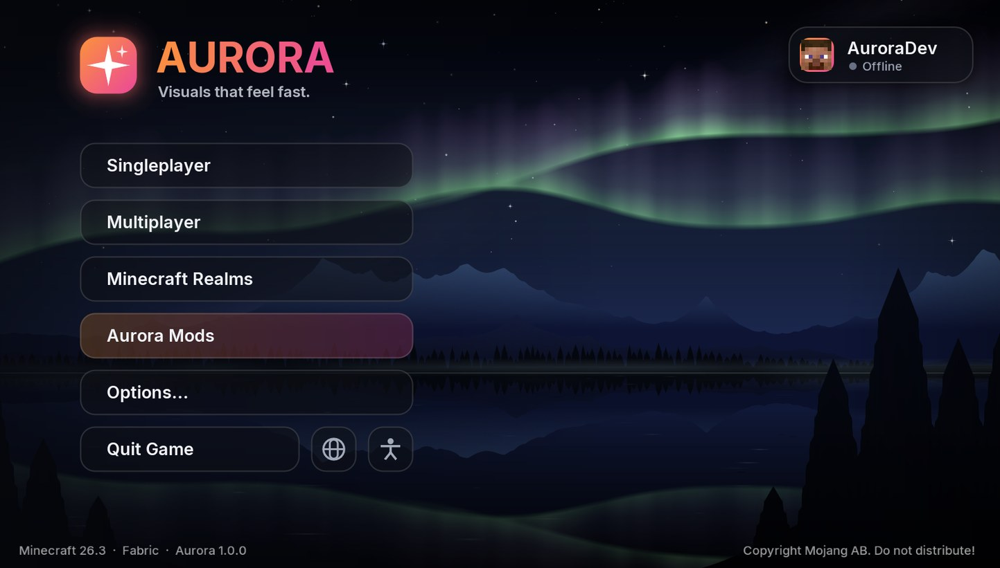 | 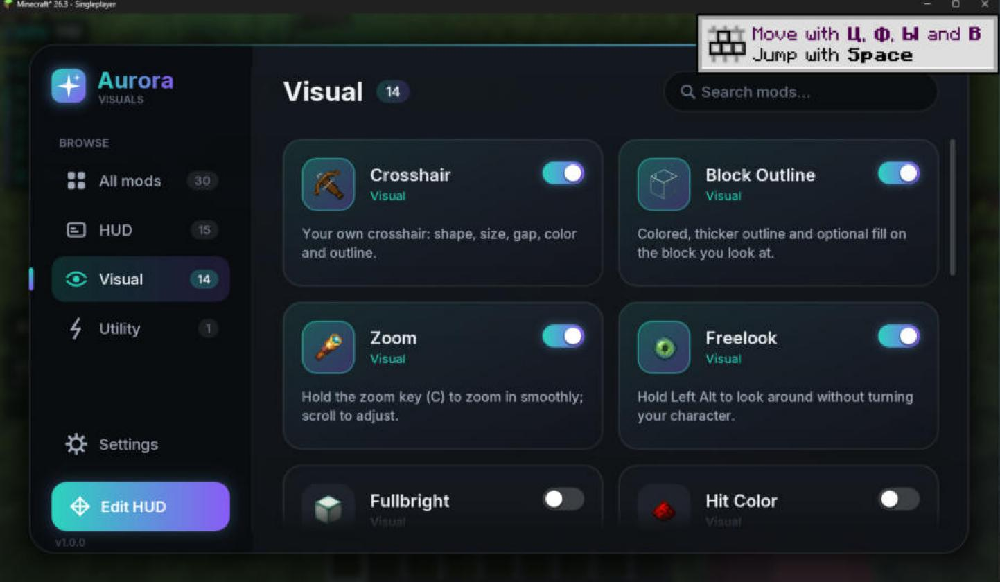 |
| **Настройки и пипетка цвета** | **Редактор HUD** |
| 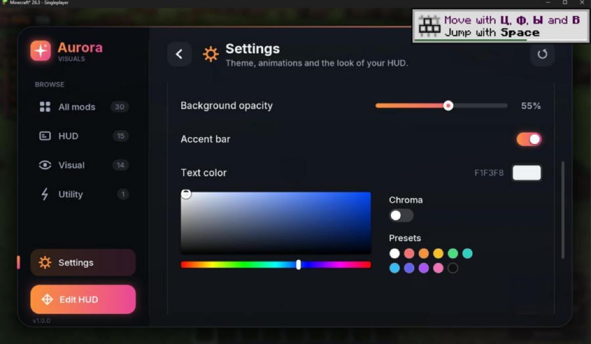 | 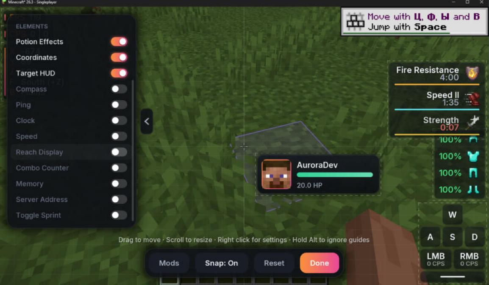 |
| **Китайская шляпа и круг прыжка** | **HUD и стеклянный хотбар** |
| 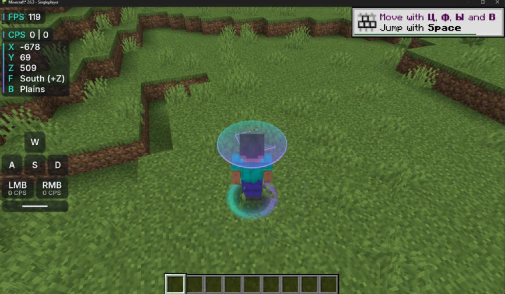 | 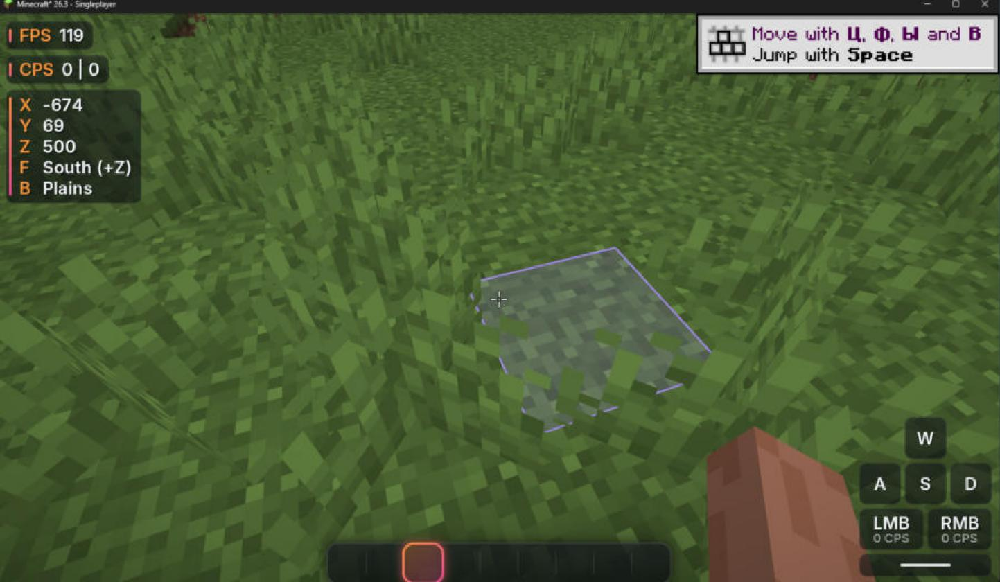 |
| **Вкладка «Бинды»** | **Target HUD с головой моба** |
| 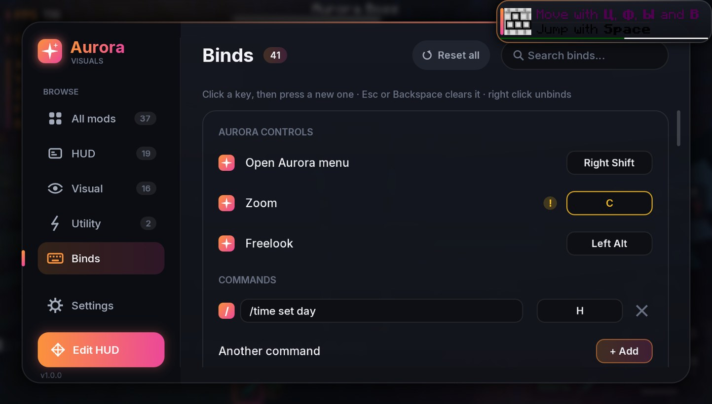 | 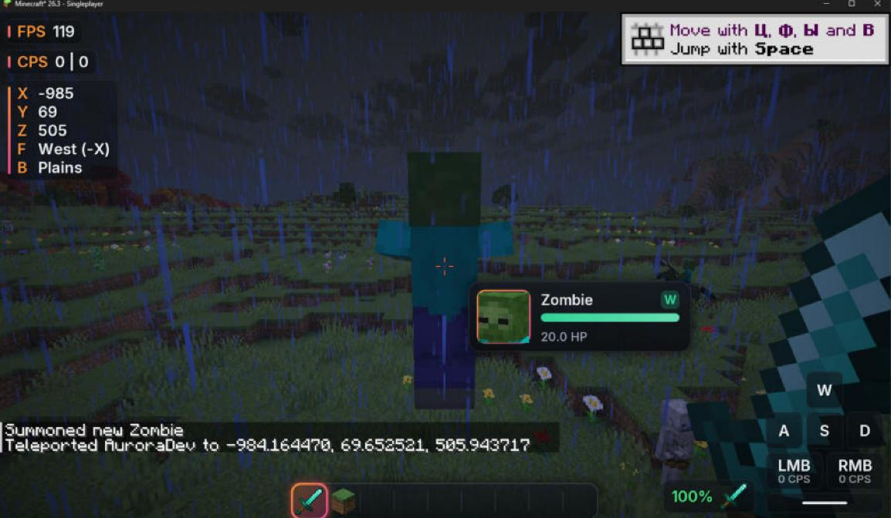 |
| **Фон меню «Закат»** | **Фон меню «Синтвейв»** |
| 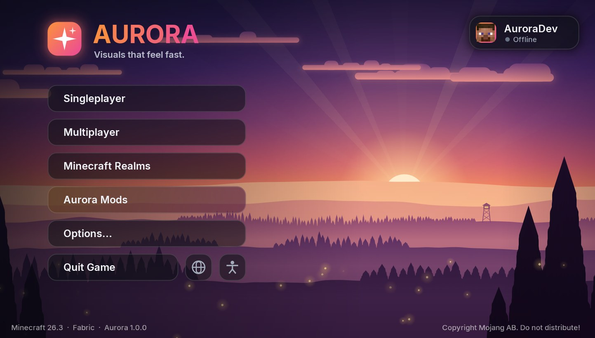 | 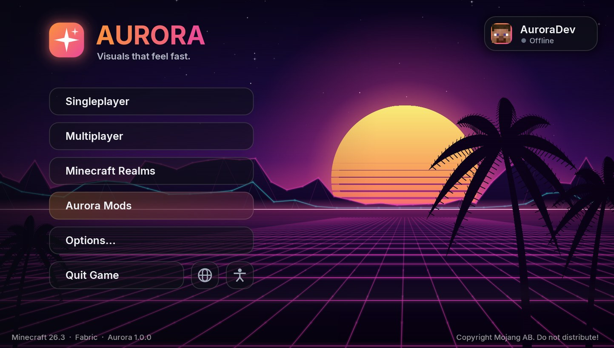 |
| **Чат, скорборд, боссбар и хитбоксы** | **Таб с пингом в мс** |
| 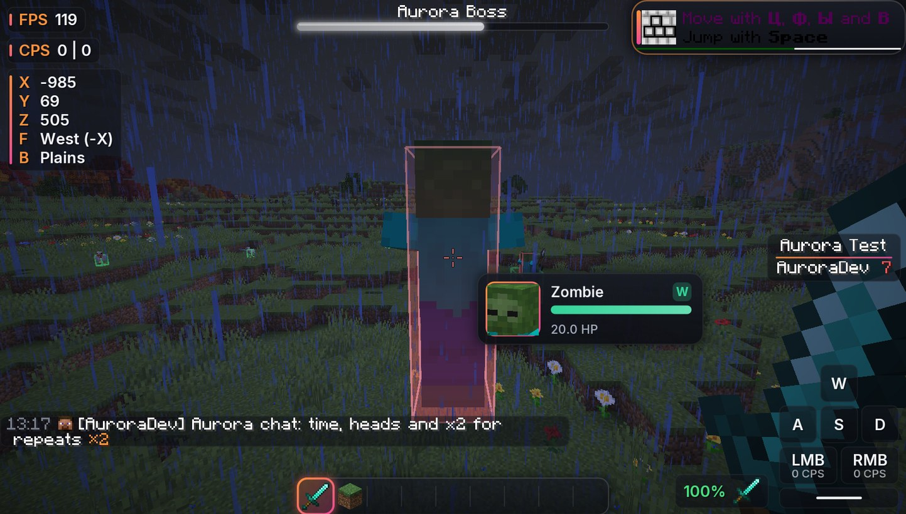 | 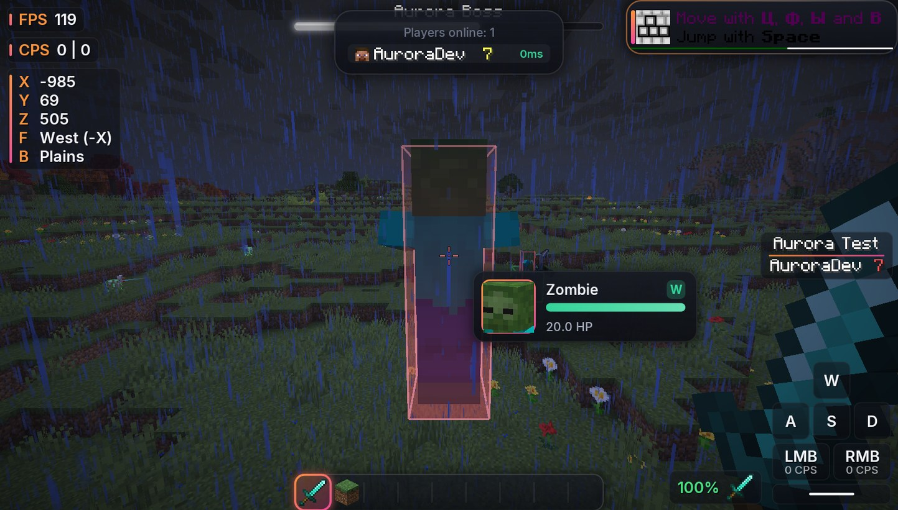 |
| **Меню паузы** | **Аккаунты** |
| 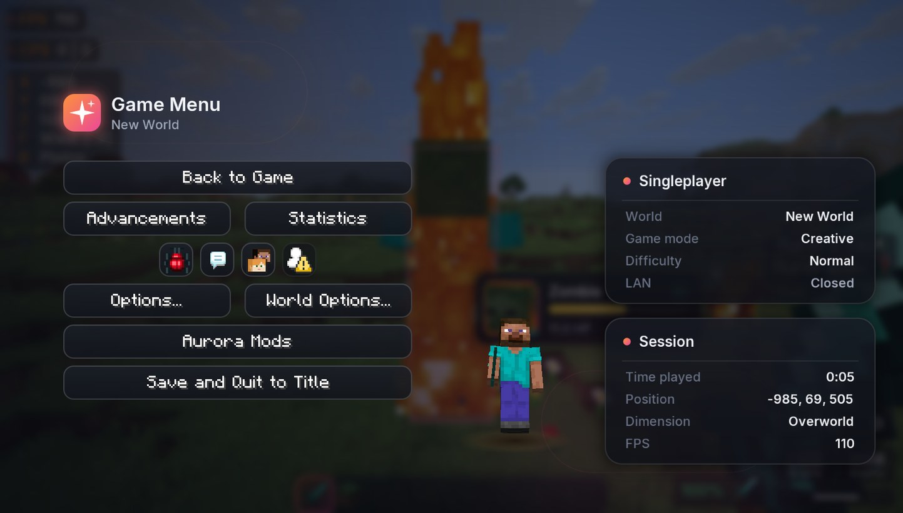 | 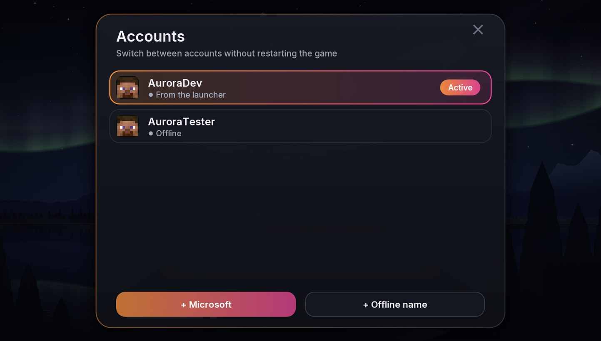 |

## Лаунчер

| Aurora Launcher | Серверы с онлайном и пингом |
|---|---|
| 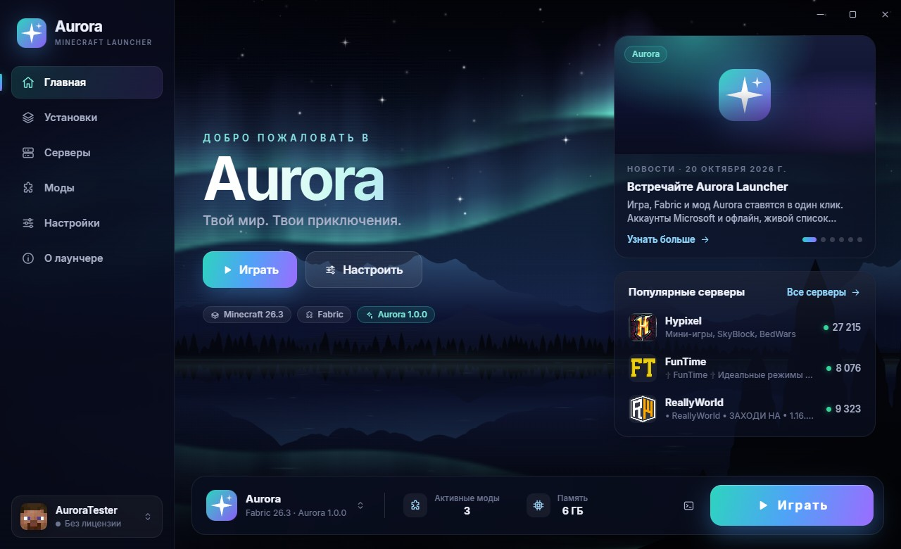 | 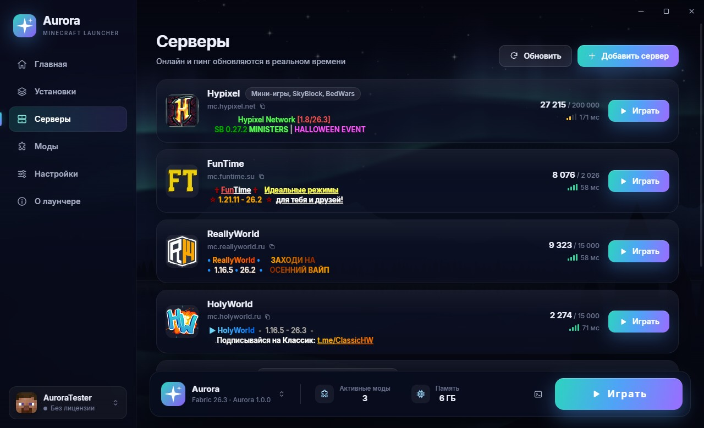 |
| **Моды и каталог Modrinth** | **Настройки** |
| 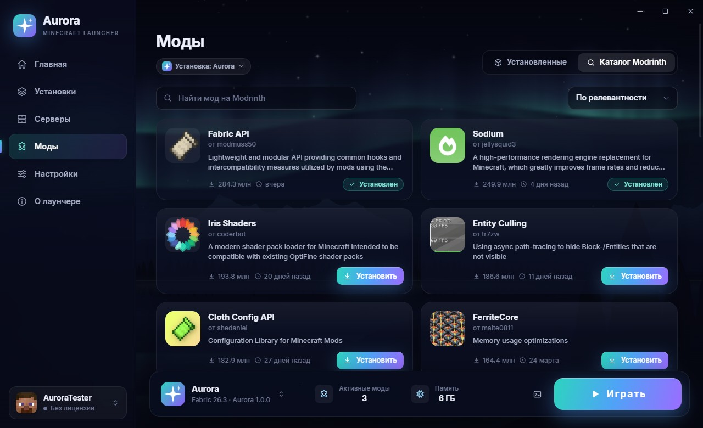 | 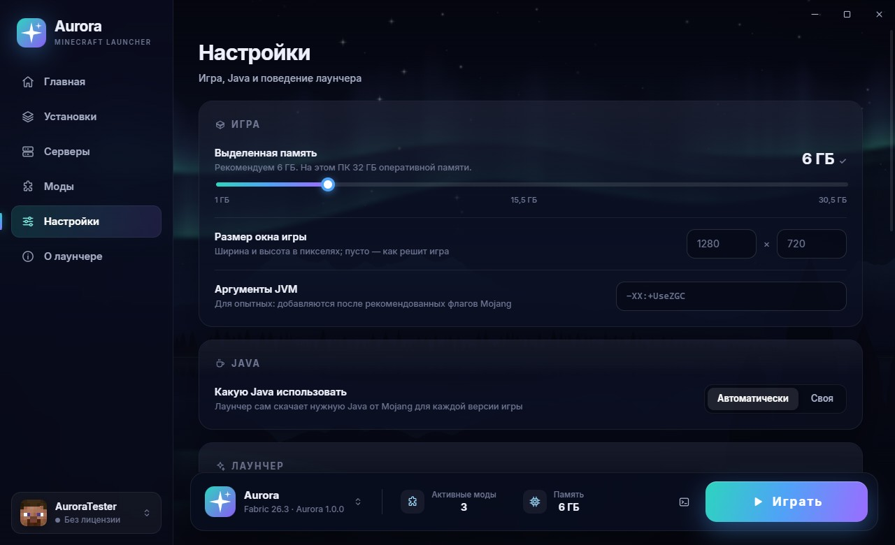 |

Самый простой способ играть с Aurora — установщик `AuroraLauncher-Setup-1.0.0.exe` (собирается из папки [`launcher`](launcher/README.md) командой `npm run dist`). Лаунчер сам скачает игру, Java 25 от Mojang, Fabric, Fabric API и мод, а при обновлении лаунчера обновит и Aurora. Подробности — в [README лаунчера](launcher/README.md).

## Установка вручную

1. Установите [Fabric Loader](https://fabricmc.net/use/) **0.19.5+** для Minecraft **26.3**.
2. Положите в папку `mods`:
   - `aurora-1.0.0+26.3.jar` (из `build/libs/` после сборки);
   - [Fabric API](https://modrinth.com/mod/fabric-api) **0.164.0+26.3** или новее.
3. Нужна Java 25 (её ставит официальный лаунчер для 26.x).

## Управление

| Клавиша | Действие |
|---|---|
| **Right Shift** | Меню модов Aurora |
| **C** (удерживать) | Зум; колёсико меняет кратность |
| **Left Alt** (удерживать) | Свободный обзор (осмотреться, не поворачивая персонажа) |

Все бинды собраны на вкладке **«Бинды»** в меню модов: клавиши Aurora (меню, зум, свободный обзор), **бинды команд** и клавиша вкл/выкл для каждого модуля. Нажмите на клавишу и затем новую; Esc или Backspace очищает бинд, ПКМ снимает его. Конфликты с другими биндами и ванильным управлением подсвечиваются жёлтым — при наведении видно, с чем именно. Есть поиск и «Сбросить все». Клавиши для букв подписаны латиницей независимо от раскладки. При переключении модуля клавишей появляется уведомление в правом нижнем углу.

### Бинды команд

В разделе **«Команды»** вкладки «Бинды» нажмите **«+ Добавить»**, впишите команду (например `/spawn`, `/home`, `/warp pvp`) и назначьте клавишу — подойдут и боковые кнопки мыши. Нажатие клавиши в игре отправляет команду (текст без `/` уходит в чат как сообщение) и показывает уведомление. Повторное срабатывание ограничено, чтобы случайно не заспамить. Крестик справа удаляет бинд. Модуль «Бинды команд» в разделе «Утилиты» включает и выключает их все разом.

## Меню модов

- Категории слева (Все / HUD / Визуал / Утилиты / Оптимизация), счётчики модулей, индикатор активной вкладки скользит между пунктами. Внизу рядом **«Конфиги»**, **«Бинды»** и **«Настройки»**, под ними кнопка редактора HUD.
- **Поиск**: просто начните печатать — фокус сам уйдёт в поле поиска.
- Карточка модуля: переключатель — вкл/выкл, клик по карточке — настройки, **ПКМ** по карточке — быстрое вкл/выкл.
- Настройки: переключатели, слайдеры, сегментные кнопки и выпадающие списки, пипетка цвета (насыщенность/яркость, оттенок, прозрачность, режим «Хрома», готовые цвета), назначение клавиш, сброс к умолчаниям.
- **Настройки клиента** (шестерёнка внизу слева): 8 тем оформления (Аврора, Океан, Закат, Роза, Изумруд, Багрянец, Моно и свой цвет), скорость анимаций, размытие фона, стиль HUD (Современный / Классика / Минимум), шрифт HUD (Inter / Minecraft), прозрачность фона, акцентная полоска, цвет и тень текста, главное меню Aurora.

## Конфиги

Вкладка **«Конфиги»** хранит наборы настроек целиком: какие модули включены, их настройки и раскладку HUD. Тема, клавиши и бинды команд при загрузке конфига остаются вашими.

- **Готовые:** PvP (клавиши, CPS, дистанция, комбо, Target HUD, прицел с разлётом и перезарядкой, низкий огонь), Выживание (координаты с биомом и Незером, компас, часы, счётчик предметов), Строитель (заливка блока под прицелом, всегда день и ясное небо), Минимализм и Для стрима.
- **Свои:** «Сохранить текущую» делает конфиг из того, что включено сейчас. Имя меняется прямо в строке, рядом кнопки «Сохранить текущую настройку в этот конфиг» и удаления.
- **Поделиться:** кнопка копирования кладёт в буфер код вида `AURORA1:...`, а «Вставить код» добавляет конфиг друга.
- **Отмена:** если загруженный конфиг не понравился, кнопка со стрелкой отменяет последнюю загрузку и возвращает прошлую настройку.
- **Конфиг для сервера:** впишите в поле «Авто на сервере» адрес (`hypixel.net` подходит и для `mc.hypixel.net`, можно несколько через запятую), и при заходе на этот сервер конфиг включится сам, а после выхода всё вернётся как было.

Конфиги лежат в `config/aurora/profiles`.

## Оптимизация

Раздел **«Оптимизация»** — модуль, который даёт больше FPS, не меняя игру: дальние мобы, рамки, стойки, голограммы, выпавшие предметы, сундуки, таблички и баннеры не рисуются дальше заданной дистанции (у каждого вида своя), число частиц ограничено, а далёкие частицы не создаются вовсе. Когда окно игры в фоне, FPS снижается до выбранного (по умолчанию 15), чтобы не грузить ПК. Игроки по умолчанию не скрываются, драконы, иссушители и подсвеченные сущности видны всегда.

**Быстрая настройка** одной кнопкой выставляет и ванильную графику: «Для слабого ПК» (прорисовка 6, без облаков, минимум частиц, быстрая графика), «Баланс» и «Качество».

## Редактор HUD

Кнопка **«Редактор HUD»** в меню.

- Перетаскивайте элементы мышью — они «прилипают» к краям, центру экрана и друг к другу (направляющие подсвечиваются). **Alt** — двигать без привязки.
- **Колёсико** над элементом — масштаб 50–300 %.
- **ПКМ** — открыть настройки элемента; **стрелки** — сдвиг на 1 px (с Shift — на 10), **R** — сброс позиции, **Delete** — скрыть элемент.
- Слева — список всех элементов с переключателями (прокручивается).
- Позиция хранится относительно ближайшего края, поэтому раскладка сохраняется при смене разрешения и масштаба GUI.

## Модули

**HUD (20):** FPS (обновляется 4 раза в секунду, по желанию 1% low, график времени кадра и цвет по FPS) · CPS · Клавиши (WASD/мышь/пробел, CPS на кнопках) · Броня (прочность в % или числом, цвет по износу) · **Счётчик предметов** (стрелы, жемчуг, золотые яблоки, тотемы, зелья, фейерверки, блоки, еда и сколько всего предметов как в руке; краснеет, когда мало, и мигает при изменении) · Эффекты (иконки, время, полосы прогресса, мигание перед концом, скрытие ванильных иконок) · Координаты (направление, биом, координаты Незера) · Target HUD (голова, здоровье с «шлейфом» урона, поглощение, броня, индикатор W/L) · Компас-шкала · Пинг · Часы / таймер сессии · Скорость · Дистанция удара · Комбо · Память · Адрес сервера · Статус авто-бега · **Скорборд** · **Полоса босса** · **Список игроков (таб)** · **Чат**.

**Визуал (16):** **Хитбоксы** · Прицел (6 форм, цвет, обводка, разлёт при движении, подсветка на цели, кольцо перезарядки, **живой предпросмотр** в настройках) · Обводка блока (цвет, толщина, заливка) · Зум (плавный, колёсико, кинематографичная камера, пониженная чувствительность) · Свободный обзор · Полная яркость · Цвет урона · Частицы (множитель, криты и искры остроты на каждом ударе) · Круги прыжка · Китайская шляпа · Шлейф · Время суток (фиксированное или анимированный цикл) · Ясная погода · Вид руки · Хотбар (плавное выделение, стеклянный стиль) · Камера и оверлеи (без тряски от урона, ниже огонь, без тыквы).

**Утилиты:** Авто-бег (через ванильный режим переключения, поэтому все правила бега сохраняются) · Бинды команд · **Mouse Tweaks** · **Скриншоты** · **Статус в Discord**.

**Оптимизация:** модуль «Оптимизация рендера» (см. выше).

**Предпросмотр прицела:** в настройках прицела справа маленькая сцена от первого лица, и прицел в ней меняется сразу, пока двигаете ползунки. Фон на выбор — луг, снег, пустыня, пещера, Незер, ночь (настоящие текстуры блоков), чтобы проверить, виден ли прицел везде. Кнопки «Стоя / Шаг / Бег / Прыжок» показывают разлёт при движении. Мимо ходит зомби: когда прицел на нём, видна подсветка цели, а клик по сцене — удар с кольцом перезарядки. Увеличение 1x/2x/4x помогает выставить толщину до пикселя.

**Mouse Tweaks** — перенос оригинального мода Mouse Tweaks, работает во всех инвентарях, включая творческий:

- **Shift + ЛКМ, протянуть по слотам** (курсор пустой) — все стаки, над которыми прошла мышь, переносятся в другую часть экрана, как при Shift-клике.
- **ЛКМ на стаке и протянуть** по слотам с таким же предметом — они собираются на курсор; с зажатым Shift такие предметы переносятся в другую часть экрана.
- **ПКМ с предметом на курсоре, протянуть** — в каждый слот на пути кладётся по одному предмету, и при повторном проходе ещё по одному.
- **Колёсико над стаком** — переносит предметы по одному в другую часть экрана (сундук и инвентарь, хотбар и инвентарь), в обратную сторону — забирает обратно. Над результатом крафта колёсико крафтит и раскладывает готовые предметы.

В настройках модуля каждую функцию можно выключить, а у колёсика выбрать направление (в том числе «к другому инвентарю»), откуда брать предметы и сколько предметов переносить за щелчок. Всё делается обычными кликами, поэтому работает на любом сервере.

**Статус в Discord** (Rich Presence): в профиле Discord видно «Играет в Aurora Client» и где вы: в главном меню, выбираете сервер, в одиночной игре, по локальной сети, на Realms или на сервере с его адресом, а ещё измерение и время в игре. У лицензионного аккаунта рядом с логотипом видна голова скина. Под статусом есть кнопка «Скачать Aurora Client»: она ведёт на страницу мода из `homepage` в `fabric.mod.json`. Адрес сервера, название мира, измерение, голову, время и кнопку можно скрыть в настройках модуля. Нужно запущенное приложение Discord на этом же компьютере; если его запустить позже, статус появится сам.

**Скриншоты:** по F2 снимок сразу копируется в буфер обмена (вставляется в Discord или Telegram через Ctrl+V), в углу появляется уведомление с превью, а к сообщению в чате добавляется ссылка на папку.

**Хитбоксы** — как F3+B, только красиво: рамка или «уголки» с настраиваемой толщиной, мягкая заливка, которая растворяется кверху, направление взгляда и уровень глаз, подсветка сущности под прицелом, цвета по типу (игроки — цвет темы, враждебные мобы — красный, мирные мобы, то есть животные, жители и големы, — зелёный, предметы — жёлтый, снаряды — голубой) или свой цвет. Можно выбрать, у кого показывать, и дальность. Стены закрывают хитбоксы так же, как саму сущность.

**Чат:** строки лежат на одной скруглённой панели, новые сообщения плавно выезжают снизу, поле ввода — стеклянное. У сообщений есть время и голова отправителя (у сообщений игроков и у системных, которые начинаются с ника), одинаковые сообщения подряд схлопываются в «×3». Сообщения, где кто-то написал ваш ник, подсвечиваются акцентной полоской и звучат коротким сигналом. **ПКМ** по сообщению копирует его текст. Ссылки, подсказки при наведении и клики по сообщениям работают как в ванилле.

**Скорборд** стал HUD-элементом: его можно двигать и масштабировать в редакторе HUD, он рисуется в выбранном стиле HUD, а красные цифры очков можно скрыть. **Полоса босса** тоже двигается: полосы плавные, в цвете босса, с делениями для «зубчатых» полос. **Таб** — стеклянная панель с головами игроков, пингом в миллисекундах с цветом по качеству, очками, шапкой и подвалом сервера и счётчиком игроков.

**Тосты** (достижения, рецепты, системные сообщения, музыка, друзья) получили стеклянные карточки с акцентной полоской.

**Меню паузы:** кнопки ванильного меню (со всеми их функциями: друзья, ссылки и диалоги сервера, жалобы) собраны в колонку слева под шапкой Aurora, добавлена кнопка «Aurora Mods». Справа — карточки «Мир» или «Сервер» (название, режим, сложность, LAN или адрес, пинг, игроки) и «Сессия» (время в игре, координаты, измерение, FPS), а между ними — модель игрока, которая поворачивается за мышью. Отключается в настройках клиента.

**Экраны загрузки:** при запуске игры вместо логотипа Mojang — заставка Aurora на фоне анимированной сцены меню с плавной полосой загрузки, которая перетекает прямо в главное меню. Загрузка мира, подключение к серверу, создание мира и короткие ожидания вроде «Сохранение мира» показывают ту же сцену, стеклянную карточку с вращающимся кольцом вокруг логотипа, прогресс (если он известен) и подсказку по Aurora внизу. Отключается в настройках клиента.

## Аккаунты

Нажмите на карточку профиля в правом верхнем углу главного меню — откроется переключатель аккаунтов. Сменить аккаунт можно без перезапуска игры (только вне мира); выбор запоминается и восстанавливается при следующем запуске.

- **Из лаунчера** — аккаунт, с которым запущена игра; к нему всегда можно вернуться. Если игра запущена из Aurora Launcher, при старте используется аккаунт, выбранный в лаунчере, а не тот, что выбирали в игре в прошлый раз.
- **Без лицензии** — любой ник (3–16 латинских букв, цифр или `_`) для одиночной игры, LAN и серверов без проверки лицензии.
- **Microsoft** — вход через браузер: Aurora показывает короткий код, вы открываете microsoft.com/link и вводите его, так что пароль Aurora не видит. Для этого нужен **Client ID** приложения Azure: зарегистрируйте приложение на portal.azure.com (личные учётные записи Microsoft, включены *public client flows*) и подайте заявку Mojang на доступ к входу в Minecraft: [aka.ms/mce-reviewappid](https://aka.ms/mce-reviewappid). Client ID вводится один раз при первом нажатии «+ Microsoft». Неодобренные приложения Mojang не пускает, и Aurora так и напишет.

При переключении меняется вся сессия: подпись сообщений чата, друзья, жалобы, телеметрия и Realms. Скин офлайн-аккаунта, нарисованный или загруженный в лаунчере, игра показывает на вашем персонаже. Его видите вы: другим игрокам сервер скин офлайн-аккаунта не передаёт. Аккаунты хранятся в `config/aurora/accounts.json`; токены Microsoft в Windows зашифрованы через DPAPI (их может прочитать только ваш пользователь Windows на этом ПК).

**Главное меню Aurora:** живой анимированный фон, карточка профиля, быстрый доступ к модам. Отключается в настройках клиента.

**Фон меню** (настройки клиента → «Фон меню») — заменяет вращающуюся панораму во всех меню, на экранах вроде «Одиночной игры» он виден размытым под затемнением:

- **Северное сияние** (по умолчанию) — ночное горное озеро: переливающиеся занавеси сияния, снежные пики, еловый берег, отражения в воде, рябь, туман над водой, мерцающие звёзды, Млечный Путь и падающие звёзды. Цвет сияния слегка подстраивается под тему.
- **Закат** — тёплый вечер в холмах в духе Firewatch: слои гор в дымке, низкое солнце с лучами, плывущие облака, стая птиц, светлячки и пожарная вышка с горящим окном.
- **Синтвейв** — ретровейв: солнце в полоску, неоновая сетка, бегущая к зрителю, каркасные горы, качающиеся пальмы и лёгкие VHS-полосы.
- **Своя картинка** — PNG, JPG, BMP или **анимированный GIF** из папки `config/aurora/backgrounds` (кнопка «Открыть папку» в настройках). Картинка подгоняется под экран, медленно плывёт и приближается (эффект Кена Бёрнса), пиксель-арт остаётся чётким. Несколько файлов — слайд-шоу с плавной сменой каждые ~40 секунд. Новые файлы подхватываются без перезапуска.
- **Панорама Minecraft** — ванильная панорама.

Сцены рисуются в реальном времени и не зависят от разрешения. Слои сдвигаются вслед за мышью (параллакс, отключается). Скорость анимации берётся из ванильной настройки «Скорость панорамы» в «Специальных возможностях»: при нуле фон замирает.

**Стиль Aurora для меню игры:** «Одиночная игра», «Сетевая игра», настройки, меню паузы и остальные ванильные экраны получают тот же вид: стеклянные кнопки с акцентной подсветкой, скруглённые поля ввода, слайдеры и чекбоксы, карточки миров и серверов, акцентное выделение в списках, тонкие скроллбары, новые подсказки и тёмный фон с мягким свечением. Все функции ванильных экранов работают как прежде — меняется только отрисовка. Отключается в настройках клиента.

**Target HUD** показывает живой 3D-портрет головы моба (любого, включая мобов из других модов), а для игроков — лицо со скина.

Интерфейс полностью переведён на русский и английский — язык берётся из настроек игры.

## Сборка из исходников

Нужен JDK 25.

```bash
./gradlew build
```

Готовый мод: `build/libs/aurora-1.0.0+26.3.jar`. Запуск тестового клиента: `./gradlew runClient`.

Статус в Discord показывается от имени приложения Discord, чей ID записан в `DiscordModule.APP_ID` (и в `launcher/src/main/defaults.js`, `DISCORD_APP_ID`). Имя приложения — то, что друзья видят после «Играет в», а логотип лежит в его Rich Presence → Art Assets под ключом `aurora` (картинка — `launcher/build/discord-logo.png`).

## Выпуск новой версии

1. Поднимите `mod_version` в `gradle.properties` (например `1.0.1`) и соберите мод: `./gradlew build`.
2. Загрузите `build/libs/aurora-<версия>+26.3.jar` на [Modrinth](https://modrinth.com/mod/L7X9iCgB) (загрузчик Fabric, версия Minecraft 26.3, только клиент, обязательная зависимость Fabric API) и на CurseForge. Что вписывать в каждое поле — в [`publish/MODRINTH.md`](publish/MODRINTH.md).
3. Всё: Aurora Launcher раз в час и перед каждым запуском смотрит версии проекта Aurora на Modrinth (по его ID в `launcher/src/main/defaults.js`, `AURORA_MODRINTH`) и сам ставит более новую, если внутри действительно Aurora, поэтому выпускать новый лаунчер ради обновления мода не нужно. Сборка для новой версии Minecraft, выложенная на Modrinth, тоже сразу становится доступна в лаунчере.

Версии с типом «alpha» лаунчер не ставит; «release» и «beta» ставит.

## Конфиг

`config/aurora.json` — состояние модулей, настройки, позиции HUD и бинды команд. `config/aurora/accounts.json` — сохранённые аккаунты. `config/aurora/profiles/` — конфиги, привязки к серверам и резервная копия для «Вернуть как было». Сохраняется при закрытии меню и выходе из игры. Если файл повреждён, Aurora сохранит его копию как `aurora.json.broken` и запустится с настройками по умолчанию.

## Устройство кода

Лаунчер (Electron) лежит в папке [`launcher`](launcher/README.md) и описан отдельно.

```
dev.aurora
├── Aurora.java            точка входа: модули, бинды, HUD-слой, события мира
├── account/               аккаунты: вход Microsoft (код устройства), хранение, смена сессии
├── config/                сохранение в JSON (атомарная запись), конфиги и их коды
├── setting/               типы настроек: bool, число, режим, цвет (с хромой), клавиша
├── module/                Module, HudModule (позиционирование), ClientSettings
│   ├── hud/               HUD-элементы
│   ├── visual/            визуальные модули
│   ├── utility/           утилиты: авто-бег, бинды команд, Mouse Tweaks, скриншоты
│   └── performance/       оптимизация рендера
├── gui/
│   ├── background/        фоны меню: сцены, силуэты гор и леса, звёзды, свои картинки и GIF
│   ├── render/            Render2D (векторные формы с AA), FontRenderer + GlyphAtlas (шрифт Inter), World3D
│   ├── widget/            переключатель, поле ввода, строки настроек, иконки, предпросмотр прицела
│   └── screen/            меню модов, редактор HUD, главное меню
├── skin/                  скины офлайн-аккаунтов из лаунчера
├── mixin/                 точечные изменения ванильного кода
└── util/                  анимации, цвета, трекеры CPS и боя, картинки в буфер обмена Windows
```

Aurora распространяется по лицензии MIT (`LICENSE`). Шрифт Inter распространяется по лицензии SIL Open Font License 1.1 (`assets/aurora/fonts/Inter-OFL.txt`).

Модуль Mouse Tweaks перенесён из [Mouse Tweaks](https://github.com/YaLTeR/MouseTweaks) Ивана Молодецких (YaLTeR), BSD 3-Clause License, Copyright (c) 2023, Ivan Molodetskikh. Текст лицензии — в `assets/aurora/licenses/MouseTweaks-LICENSE.txt`.
