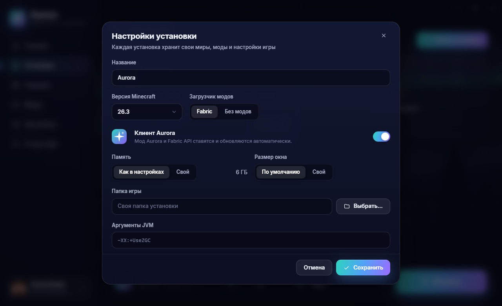

# Aurora Launcher

A Minecraft launcher that installs and starts the game together with the [Aurora](../README.md) client: Minecraft 26.3, Fabric, Fabric API and the Aurora mod are installed with a single "Play" button. A frameless window in the mod's style: glass, deep navy and teal-to-violet accents. Behind it runs the same live scene with the northern lights over a mountain lake as in Aurora's main menu in game.

**[Download the latest version](https://github.com/K1llSofix/aurora/releases/latest)**

| Home | Servers |
|---|---|
|  |  |
| **Mods and the Modrinth catalog** | **Installation settings** |
|  |  |

## Features

- **One-click install.** Downloads the game version, libraries, assets and Java 25 from Mojang (no Java of your own needed), Fabric Loader and an up-to-date Fabric API, and puts the Aurora mod in place. Every file is checked by SHA-1, downloads run in 16 threads and resume after a dropped connection. Progress, speed and time left show on the button and in the bottom bar. Later launches check the files in a second and download nothing extra. Aurora updates by itself: once an hour and before every launch, the launcher looks up the mod's versions on [Modrinth](https://modrinth.com/mod/L7X9iCgB) and installs one newer than the bundled build, checking its SHA-1 and that it really is Aurora inside. Support for new Minecraft versions arrives the same way: publishing a build of the mod for them is enough. Offline, or while the project is not published, the bundled build is used. An Aurora jar you put into an installation's `mods` folder yourself (a build you are testing) stays there, even under the same version number, until the launcher has a newer version: the launcher remembers which build it installed and replaces only its own, or an older one.
- **Accounts.** Offline names (with the same skin head the game will show) and Microsoft: sign-in through the browser with a short code, so the launcher never sees your password. Tokens are encrypted with Windows' own DPAPI and refreshed before each launch. Aurora's in-game account switcher keeps working, and when the game is started from the launcher, the account picked in the launcher wins.
- **Servers.** A live list: server icons, colored MOTDs, players online and ping (the same status request the game's "Multiplayer" screen uses). The "Play" button starts the game straight onto the chosen server. You can add and remove your own servers.
- **Modpacks.** The "Modpacks" tab on the Mods page searches the Modrinth catalog for Fabric modpacks. A modpack becomes an installation of its own with its own folder: the dialog lets you pick the version (searchable by number or Minecraft version) and the name, and for versions Aurora supports, the mod can be added with one switch. The launcher downloads the pack's files checking their SHA-1, copies its settings (`overrides`, then `client-overrides`) and pins the Fabric Loader version it needs; the pack's icon becomes the installation's icon. Your own `.mrpack` file installs from the "Install a modpack" card on the Installations page, or by dropping it onto that page. Modpacks for Forge, NeoForge and Quilt are turned down with a clear message, and paths leading outside the installation's folder or downloads from sites outside the format's list (cdn.modrinth.com, GitHub, GitLab) are refused.
- **Mods, resource packs and shaders.** The Mods page has a tab for each. Mods: a list with icons and descriptions from `fabric.mod.json`, switching on and off, deleting to the Recycle Bin, dropping `.jar` files onto the window. Resource packs: switched on right from the launcher (they go into `options.txt` in the right order), dropping `.zip` files. Shaders: the active shader in one click, and if Iris is not there yet, the launcher offers to install it together with Sodium. The [Modrinth](https://modrinth.com) catalog in every tab shows only what fits the installation's version, installs mods with their required dependencies, and switches a downloaded resource pack or shader on right away. **Check for updates** (the round arrow) asks Modrinth for newer versions of everything it knows in the tab, for the installation's Minecraft version; "Update all" or one at a time downloads the new file, checks its SHA-1, moves the old one to the Recycle Bin and keeps it switched on (or the active shader) as before.
- **Shortcuts like in PrismLauncher.** An installation card's menu has "Desktop shortcut" and "Add to the Start menu". The shortcut starts the game straight away without the launcher window: only a small splash with the file check progress appears, and everything closes by itself after you quit the game. If the game does not start, the splash shows why, with an "Open the launcher" button.
- **Installation icons.** Every installation has its own icon: the Aurora mark, colored tiles, textures from the game itself (grass, diamond, sword, creeper, TNT and more) or any picture of your own. The same icon goes onto its shortcut and is updated there when it changes.
- **Offline account skin.** The palette button of an offline account opens the editor: a live 3D model you paint on with the mouse and the 64×64 texture. There are a pencil, an eraser, a face fill, an eyedropper, undo and redo, the outer layer and the Classic and Slim models. A skin can be loaded from a file, picked from the MineSkin gallery or taken from any licensed player by name. The game with the Aurora mod shows this skin on your character.
- **Installations.** Several installations with separate folders (worlds, mods, settings): any Minecraft version, Fabric or vanilla, their own memory, window size, game folder and JVM arguments. Aurora is switched on only where the mod supports the version. The card's menu can **make a copy** with its own folder (worlds and screenshots on request), **export it as a .mrpack** (files Modrinth knows are linked, the rest and `config/` and `options.txt` go inside; Aurora's accounts and waypoints never do) and **carry over settings** from another installation: `options.txt`, Aurora's settings and profiles, `servers.dat`, with the replaced files kept as `.bak`.
- **Worlds.** The singleplayer worlds of the selected installation with their icon, game mode, version, size and last play time (read from `level.dat`). "Play" starts the game straight into a world (Quick Play). A backup is a zip in `<game>/backups` named like the game's own "Make Backup", so both kinds show up in the list; restoring unpacks it as a new world next to the others and never overwrites one. Worlds and backups are deleted to the Recycle Bin.
- **Screenshots.** The screenshots of every installation in one grid, newest first, filtered by installation if you like. Thumbnails load as you scroll; a click opens one large with the arrow keys to flip, copy to the clipboard, show in its folder and delete.
- **Playing and crashes.** While the game runs, the launcher hides to the tray and comes back after you quit (configurable). The built-in console shows the game log with warnings and errors highlighted. If the game crashes, the launcher reads the log and the crash report and names the likely cause: not enough memory, a missing or incompatible mod, a mod for another version, a failed mixin, a Java that is too old, the graphics driver, a damaged world. Most come with a one-click fix (more memory, switch the mod off, install the missing one from Modrinth, use the launcher's Java, open the driver page). "Share the log" uploads it to [mclo.gs](https://mclo.gs) after asking and copies the link.
- **Discord status.** While the launcher is open, friends see "In the Aurora Launcher" on Discord. A vanilla installation or one without Aurora shows as "Minecraft <version>", and in a game with Aurora the mod takes over with a more detailed status. Under the status there is a "Get Aurora Client" button leading to the mod's page (`AURORA_PAGE` in `defaults.js`). Can be switched off in the settings.
- **Updates itself.** Every few hours the launcher looks at the latest release on GitHub, downloads a new version in the background, checks its SHA-512 and installs it without any windows when you close the launcher. Once an update is ready, the sidebar shows "Update X.Y.Z · Restart now", and the settings have a "Check" button and an auto-update switch. Shortcuts and settings are left as they are.
- **News** from Aurora and Minecraft: Java Edition, an **English and Russian** interface, and a memory picker with a recommendation for your PC.
- **What's new.** After an update the launcher shows what came with it, from its own [CHANGELOG.md](CHANGELOG.md) and the mod's (in Russian from `src/main/changelog-ru.json`); the About page shows the whole history.
- **Graphics card and colours.** On Windows the settings can ask for the discrete GPU for the game (the per-program choice of Windows' graphics settings, for the Java that runs it), and the launcher can take the colours of the theme picked in Aurora's settings. Favourite servers stay at the top of the list.

## Installation

Download `AuroraLauncher-Setup-<version>.exe` from the [releases page](https://github.com/K1llSofix/aurora/releases/latest), run it and choose a folder. Windows SmartScreen may warn about an unknown publisher because the installer is not signed with a certificate: "More info" → "Run anyway". From then on the launcher updates itself.

The game, Java and installations are kept in `%APPDATA%\.aurora`:

```
.aurora
├── launcher.json      launcher settings, installations, servers
├── accounts.json      accounts (Microsoft tokens encrypted)
├── skins/             offline account skins
├── icons/             your installation icons and shortcut icon files
├── versions/          version files and the game client
├── libraries/         libraries
├── assets/            sounds, languages, textures
├── runtime/           Java from Mojang
├── instances/aurora/  the game folder of the "Aurora" installation: mods, worlds, settings, screenshots
└── logs/              logs of the launcher and the latest game runs
```

The first launch downloads about 700 MB.

### Microsoft sign-in

The launcher has its own Azure application, so there is nothing to set up: you type a short code on microsoft.com/link, and your password stays on Microsoft's site.

Mojang only lets approved applications into Minecraft and has not approved this one yet, so for now the sign-in gives no licensed account to play on.

### Offline accounts

A new offline name needs a Microsoft sign-in on this computer first, once. Until Mojang approves the launcher, that sign-in cannot check whether the account owns the game, so any Microsoft account with an Xbox profile passes. After approval the account has to own Minecraft: Java Edition. Names saved by an earlier version keep working.

## Development

Requires Node.js 22+ and Python 3 with Pillow (for the icon only).

```bash
npm install
npm start
```

In development the launcher takes the Aurora mod straight from `../build/libs` (build it with `gradlew build`), opens DevTools with Ctrl+Shift+I and reloads with F5.

Building the installer:

```bash
npm run dist
```

The mod's Modrinth project is set in `src/main/defaults.js` (`AURORA_MODRINTH`), and so are the Discord application (`DISCORD_APP_ID`) and the repository with the launcher's releases (`LAUNCHER_REPO`). The script puts the newest `aurora-*.jar` from `../build/libs` into `resources/mods`, builds `dist/AuroraLauncher-Setup-<version>.exe` with electron-builder and writes `dist/latest.yml` next to it for updates. `npm run icon` redraws the icon.

### Releasing an update

Installed launchers update from the releases of the public GitHub repository `LAUNCHER_REPO` (`src/main/defaults.js`, currently `K1llSofix/aurora`): they read `latest.yml` of the latest release and download the installer from the same release.

1. Raise `version` in `package.json` (for example 1.0.0 → 1.0.1).
2. `npm run dist` builds `dist/AuroraLauncher-Setup-<version>.exe` and `dist/latest.yml` (version, installer name, SHA-512, size).
3. Publish a release tagged `v<version>` with both files:
   - with the script: in PowerShell, `$env:GH_TOKEN = "<token>"; npm run release -- "What's new"`. Create the token on GitHub under Settings → Developer settings → Fine-grained tokens for this repository, with Contents: Read and write. The script makes a draft first, uploads the files and only then publishes, so launchers never see a release without its files;
   - or by hand: Releases → Draft a new release, tag `v<version>`, attach both files, Publish release.

Launchers see the release within six hours, or right away with the "Check" button in the settings. Drafts and pre-releases do not count as the latest release. Updates can be tested without GitHub: put `latest.yml` and the installer into a folder, serve it locally (`python -m http.server 8765`) and run `AURORA_UPDATE_FEED=http://127.0.0.1:8765 AURORA_UPDATE_DRY=1 npm start`. With `AURORA_UPDATE_DRY` the installer is not started, only written to the log.

Helper scripts:

- `node scripts/smoke.js [--launch]` sets up the Aurora installation without the interface and (with `--launch`) starts the game with an offline account;
- `AURORA_SCRIPT=scripts/shots.js AURORA_HIDDEN=1 npx electron .` renders the window offscreen and saves screenshots of every page to `shots/` (`AURORA_PLAN` sets the plan);
- `trailer/` builds the launcher's trailer: filming the interface, the voice, the music and the edit, all from code (see [`trailer/README.md`](trailer/README.md)).

## How it works

```
src
├── main/                  Electron main process (Node.js)
│   ├── main.js            window, tray, the app:// protocol, IPC, the game's lifecycle
│   ├── preload.js         a narrow window.aurora bridge for the interface
│   ├── defaults.js        default settings, installation and servers, Aurora news
│   └── core/
│       ├── net.js         HTTP: JSON, downloads checked by SHA-1, a worker pool, retries
│       ├── versions.js    Mojang's manifest, versions, Fabric profiles
│       ├── java.js        Java from Mojang for every game version
│       ├── installer.js   preparing an installation: client, libraries, assets, natives
│       ├── mods.js        mods: fabric.mod.json, Aurora and Fabric API, Modrinth
│       ├── packs.js       resource packs and shaders: options.txt, iris.properties, Modrinth
│       ├── modpacks.js    .mrpack modpacks: the Modrinth catalog, checks and installation
│       ├── skins.js       offline account skins, MineSkin, skins by name
│       ├── icons.js       installation icons from the game's textures, .ico files for shortcuts
│       ├── launch.js      launch arguments, the game process, parsing the log4j log
│       ├── accounts.js    offline and Microsoft (device code → Xbox → Minecraft), skins
│       ├── servers.js     Server List Ping
│       ├── news.js        Minecraft news
│       ├── discord.js     Discord status over Discord's local pipe
│       ├── updater.js     launcher updates from GitHub releases: latest.yml, SHA-512, silent install
│       ├── rules.js       OS and feature rules from version files, Maven paths
│       └── zip.js         reading jars without unpacking them
└── renderer/              the interface (HTML, CSS, JS modules without a bundler)
    ├── index.html
    ├── styles/app.css
    └── js/
        ├── app.js         shell, navigation, the "Play" button, console, crashes
        ├── scene.js       animated background (a canvas port of the mod's AuroraScene)
        ├── accounts.js    the account card and dialogs
        ├── skin-editor.js skin editor: 3D model, texture, gallery
        ├── modpack-install.js modpack install dialog: version, name, download
        ├── icons.js       interface and installation icons
        ├── splash.js      the splash for shortcut launches
        ├── dom.js         DOM building, dialogs, menus, tooltips, MOTD, skin heads
        ├── i18n.js        English and Russian
        └── pages/         home, installations, servers, mods, settings, about
```

A shortcut runs `AuroraLauncher.exe --launch <installation id>`. Such a start does not open the main window: the launcher checks the files, starts the game and closes after you quit it. If the launcher is already open, the command is handed to it.

The interface runs sandboxed (contextIsolation, sandbox, a strict CSP) and talks to the system only through `preload.js`. External links open in the browser.

Not an official Minecraft product. Not approved by or associated with Mojang or Microsoft.
